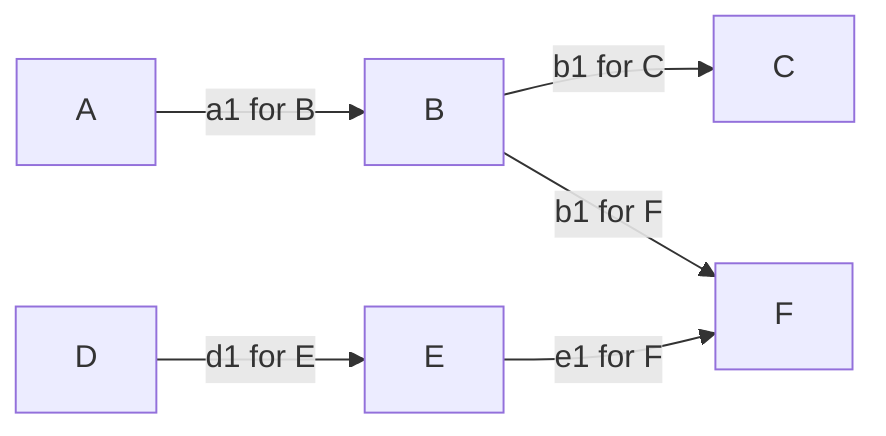

# Native governed parallel engineering

Status: **PLANNED; native acceptance scenarios NOT_RUN**. Contract revision: **NGE-1**.
This is the single design contract for Cortex's native Rust parallel-engineering
control plane, under [CAP-WFL-004](../product/capability-catalog.md#cap-wfl-004).
The [catalog](../product/capability-catalog.md) owns functional scope/status,
[roadmap](../product/roadmap.md#native-parallel-delivery-sequence) owns sequence,
[invariants](core-invariants.md) own shared semantics and
[subsystems](subsystems.md) own logical responsibilities. Requirement labels below
are traceability within that capability, not additional capability IDs.

Cortex will implement this control plane in Rust within the existing domain,
evidence and infrastructure boundaries. It will not delegate orchestration authority
to a third-party orchestration framework, workflow service, broker, scheduler or
separate development orchestrator. The selected Codex CLI is a future supervised
executor, not the planner, permission authority, workflow record owner or integrator.
Existing Git, OS and approved encrypted-storage mechanisms remain infrastructure;
this contract does not replace cryptography, inference or those mechanisms.

## Present implementation and first boundary

The inspected workspace has three crates: std-only `cortex-core` (contracts,
binding, temporal records and immutable reference knowledge), `cortex-evidence`
(Core-dependent observations/assessments) and `cortex-cli` (Git/JSON capture,
explicit encrypted history and existing commands). Their dependency direction is
CLI -> Evidence -> Core, with CLI also consuming Core. There is no native runner,
mission scheduler, general policy enforcement or authoritative method selector.
Current [binding](candidate-binding.md), [evidence](unified-evidence.md),
[knowledge](knowledge-references.md) and [history](temporal-records.md) APIs retain
only their delivered bounded meanings. Manual parallel development is external
practice, not native implementation or measured acceleration.

The first proposed code mission, [G1](#g1-in-memory-readiness-projection), is a useful
pure in-memory graph/event-to-decision operation. Its outputs describe readiness
under supplied facts; they neither authenticate those facts nor authorize effects.
Production Evidence integration, durable execution and host/process control are
subsequent gates. Milestone 003 stays IN_PROGRESS; 004 and CAP-WFL-004 stay PLANNED.
Accepting this specification does not authorize G1 implementation or dispatch.

For material decisions in every NGE-R01–R16 requirement, retain the NGE contract
revision, relevant mission/graph/artifact revisions, actual candidate contexts,
mechanism/environment/oracle dependencies, supporting observation/assessment
references and separate approval reference. Applicability and freshness use the
existing Evidence semantics; changed inputs invalidate the affected decision basis.
Sections below name additional prerequisites and discriminating refusals. Harmless
Signal content does not require an acceptance assessment or ownership ceremony.

## NGE-R01 — Outcomes and responsibility

**Owner:** CAP-WFL-004; accepted task/acceptance identity uses CAP-CORE-003.
**Prerequisite:** explicit owner outcomes, named roles and protected acceptance revision.

A **program** groups owner-accepted outcomes and their acceptance obligations.
A **workstream** owns a cohesive responsibility across increments, interfaces and
missions. A **mission** delivers a bounded meaningful functional outcome with an
inspectable exit; it need not equal a milestone, crate, session or small file edit.
A released intermediate artifact can be useful before its mission is complete.

The owner approves outcomes, exceptions and consequential acceptance. The planner
proposes decomposition and dependencies. The coordinator reconciles edge releases,
resource decisions and integrated acceptance within its delegated scope. Executors
produce contracted artifacts and observations. One person may perform several
roles, but a role label or separate process does not establish independent review.
An executor cannot approve its own consequential promotion. Store the mission's
acceptance baseline separately from its mutable execution plan; amendments require
an authorized new revision, retained prior basis and affected new evidence.

**Refusal/acceptance:** a producer declaring its whole mission complete cannot
satisfy a missing fan-in or revise a protected oracle. Fixture A below remains
active after its intermediate output is accepted for B.

## NGE-R02 — Contracted work

**Owner:** CAP-CORE-003; CAP-WFL-004 consumes the reviewed contract.
**Prerequisite:** current task/candidate correspondence and applicable owner authority.

A mission contract retains: program/workstream references; `TaskId` and
`ContractRevision`; outcome and protected behavior/acceptance baseline; input and
output artifact contracts; source/consumer candidate and capture references;
required edges/levels/predicates; owned files/resources and protected interfaces;
allowed effects, tools, data/path/network scopes; delegated permissions and their
limits; pre/postconditions and exceptions; resource/termination/cancellation and
uncertain-outcome conditions; required evidence; and approval owner/reference.
These fields are versioned material, not permissions inferred from a prompt.

Reuse existing task, binding and observation types. Full Git IDs do not identify
dirty bytes or prove object existence. Each mission and integrated artifact retains
its own exact candidate even under a shared program base. Preserve source-to-consumer
correspondence explicitly; identical commits in different worktrees do not imply
identical local context. No inherited obligation can disappear through delegation.

**Refusal/acceptance:** wrong contract revision, changed acceptance under the same
revision, unbound candidate, absent data authority or broader child effects prevent
operational admission. G1 rejects aliases and mismatched references within supplied
inputs, while declaring their capture/authentication unestablished.

## NGE-R03 — Native dependency graph

**Owner:** CAP-WFL-004, constrained by CAP-CORE-003.
**Prerequisite:** uniquely scoped mission/artifact IDs and reviewed graph revision.

A typed directed graph links producer outputs or mission-completion artifacts to
consumer requirements. Each edge names producer, consumer, exact artifact role,
compatible contract revision(s), required readiness level, acceptance predicates,
verification coverage/context and release authority. Edge kinds distinguish
mission acceptance (all protected exits evidenced and accepted) from availability
of one named artifact; a reported done message cannot satisfy the former.
Required fan-out edges are
independent; required fan-in is conjunctive. An optional edge may be omitted only
under its accepted explicit condition, not because its producer is late.

Edges represent semantic dependencies (schema, invariant, oracle, protocol,
acceptance or shared environment), independently of file overlap. A graph revision
names its predecessor and actual changed requirements; adding/removing/retyping an
edge is reviewed contract work. Reject cycles with a bounded diagnostic, self-edges,
ambiguous IDs, duplicate conflicting edge identities and unresolved endpoints.
Rejected updates preserve the accepted graph and releases. Stable lexical ID order
may make reports reproducible; it must not resolve conflicting semantics.

**Refusal/acceptance:** disjoint files cannot make B independent of A's unfrozen
interface; F below needs both B and E. Adding C -> A to A -> B -> C is refused.

## NGE-R04 — Three dependency readiness levels

**Owner:** CAP-WFL-004; evidence validity remains CAP-EVD-003.
**Prerequisite:** the consumer declares the exact level and compatibility predicate.

| Level | Required meaning | Permitted and forbidden use |
| --- | --- | --- |
| `CONTRACT_STABLE` | Reviewed immutable interface/acceptance revision, applicable to this edge | May support separately authorized non-effectful reasoning or simulation. It supplies neither implementation nor permission to execute dependent effects |
| `IMPLEMENTATION_PROVISIONAL` | Exact retained implementation artifact and observations; integration/acceptance outstanding | Only an explicitly approved provisional-use contract can consume it, with named risk, isolation, revalidation, stop/rework and cost owner. It cannot satisfy an integrated requirement |
| `INTEGRATED_ACCEPTED` | Exact artifact admitted into a distinct reviewed integrated candidate with required current acceptance evidence and authority | May satisfy that consumer's declared dependency. Dispatch still needs its own current grant, resources and effective host controls |

These are dependency predicates, not Evidence result or validity states, nor a
universal numeric quality ordering. A different revision is not compatible merely
because its label is "higher". Default effectful downstream requirements to
INTEGRATED_ACCEPTED; no implicit downgrade exists. Provisional acceptance policy is
open before any such operational use. G1 models levels but executes no downstream work.

**Refusal/acceptance:** stabilized A permits only the contracted non-effectful B
preview. Provisional A source cannot release an integrated-only consumer; an accepted
A revision can release B while another consumer requiring revision 2 stays held.

## NGE-R05 — Evidence-gated per-edge release

**Owner:** CAP-WFL-004 coordinator decision, CAP-CORE-003 authority,
CAP-EVD-002/003 observations and contextual validity.
**Prerequisite:** inspected support and a current scoped coordinator review.

A producer reports an exact output identity/version, content correspondence,
contract revision, candidate/capture, verification observations and limitations.
The coordinator evaluates a particular edge: matching artifact and consumer
contract, sufficient level, required predicates, applicable current evidence and
its declared oracle/coverage, compatibility, conflicts and authority. Record
**accept**, **hold** or **reject** with cause and supporting references. Hold covers
missing/unestablished support; reject covers a demonstrated incompatibility or
invalid proposal. Neither is an Evidence verdict. Preserve the original report
and assessment identities rather than relabeling them as coordinator observations.

A release binds graph/edge/artifact/consumer revisions, both candidate contexts,
evidence and coordinator decision. It satisfies only that edge while this basis
remains valid. It does not complete the producer mission, satisfy sibling edges,
transfer responsibility, expand a consumer grant or prove future freshness.

**Refusal/acceptance:** a current applicable PASS for B's oracle cannot satisfy
E's different oracle or revision. An unassessed, zero-relevant-check, stale or
insufficient-oracle report cannot supply authoritative release; producer prose
and peer messages cannot substitute for this evaluation. G1's narrower asserted-fact
boundary is explicit below; it does not implement this production Evidence bridge.

## NGE-R06 — Communication operations

**Owner:** CAP-WFL-004 edge coordination; CAP-CTX-002 translation/handoffs;
CAP-CORE-003 guards consequential responsibility transfer.
**Prerequisite:** exact operation kind and referenced scope/revision.

- **Signal:** informational progress, question or reported artifact. It creates no
  release, grant or ownership transition. Harmless information needs no transfer ceremony.
- **DependencyRelease:** the per-edge decision above. Intermediate artifact passage
  does not require handing off the producer's remaining task.
- **ResponsibilityHandoff:** proposed transfer of named responsibility and its
  applicable obligations/context to a recipient. Require scope-bound acknowledgement
  when accountability changes; retain the current owner until required acknowledgement
  and authority checks complete. An acknowledgement accepts only the declared scope.

Portable content uses existing context/memory/evidence owners, not a new message
broker or handoff database. Authentication, retention and transport remain their
existing decision boundaries. **Refusal/acceptance:** acknowledging A's artifact
receipt cannot assign all of A to B or grant B new tools. G1 Signal is a no-release
event; actual responsibility transfer is deferred, not simulated as permission.

## NGE-R07 — Event-driven eligibility

**Owner:** native Rust planning/scheduling within CAP-WFL-004.
**Prerequisite:** accepted graph and explicit relevant fact/event revisions.

Recompute affected eligibility on verified artifact/release events, contract/graph
changes, integration results, invalidation and resource changes. There is no global
all-workers-complete barrier. An edge may release B while A continues; B can later
release C. Evaluate F's full required fan-in on every relevant transition.

Keep **dependency-ready**, **eligible**, **authorized**, **reserved** and **actually
dispatched** distinct. For a concrete operation, eligibility additionally requires
its applicable preconditions and available capacity. Missing authority can leave
eligible work undispatched. Resource loss leaves dependency releases inspectable
but blocks allocation/dispatch. Recheck scope, evidence, revocation and actual
reservation atomically enough for the selected effect boundary; a stale plan is
not a reservation. No event listener gains independent authority.

**Refusal/acceptance:** B becomes eligible after its A edge is accepted without
waiting for D or A completion. Removing capacity blocks B's allocation, not the
unrelated D edge; an eligible mission with no current grant is not dispatched.

## NGE-R08 — Invalidation and non-impact

**Owner:** CAP-EVD-003 validity; CAP-WFL-004 projects affected readiness.
**Prerequisite:** declared dependency/context coverage and causal change references.

Changes to contract/acceptance, source/candidate, depended-on artifacts, mechanism,
configuration, environment or oracle invalidate affected release use and dependent
readiness. Retain historical reports/releases, cause, changed reference and
transitive affected paths. Revalidation requires new appropriate observations and
an applicable release; restoring old bytes does not erase recorded invalidation.
Unknown dependency coverage blocks a current-use conclusion. Unaffected work is
preserved only with an inspectable non-impact basis over declared dependencies.

Local execution candidates can advance independently; a change to A need not
invalidate D/E when their scoped candidate/dependency basis is demonstrably
unaffected. A common acceptance/oracle change reaching both branches would affect
both. **Refusal/acceptance:** changing A's contract makes B/C/F readiness unusable,
without reflexively blocking unrelated D/E. G1 computes the graph closure of supplied
invalidation, not source discovery or a replacement Evidence validity engine.

## NGE-R09 — Scheduling and finite resources

**Owner:** CAP-WFL-004 scheduling; CAP-CORE-003 budgets; CAP-HRN-001 actual enforcement.
**Prerequisite:** DEC-005 host/operation limits, measurable availability and current grants.

Eligibility is a hard gate. Rank only eligible work using disclosed owner value,
risk, unblock/critical-path value, resource cost, coordination/rework cost and
starvation controls. Explain ties and aging; never age blocked work into permission.
No fabricated numeric weights, universal priorities or speedup target is selected.

Model worker slots separately from Cargo sessions/jobs/test threads, CPU, RAM, disk,
wall time, model tokens and CI capacity. Reservations and releases identify the
operation, owner, limits, duration/expiry basis and failure cleanup. Unknown capacity
or unenforceable required limits block allocation. Budget accounting includes child
processes/retries; changing adapters cannot reset it. A former manual two-Cargo gate
is historical evidence, not an enforced current product or host-wide default.

**Refusal/acceptance:** spare worker slots cannot admit a third build when the
accepted build capacity is exhausted. Resource changes trigger reconsideration;
no actual availability or enforcement is inferred from G1's synthetic capacities.

## NGE-R10 — Native host/process boundary

**Owner:** CAP-HRN-001/002; CAP-CORE-003 grant enforcement at dispatch.
**Prerequisite:** real host threat/denial qualification, DEC-005/006 and data-use policy.

Later Rust adapters may provision approved Git workspaces and start/supervise the
selected Codex CLI under bounded process-tree, path/tool/network, CPU/RAM/output,
timeout/cancellation and cleanup controls. Negotiate actual executor capabilities;
unsupported required denial controls prevent use. Git worktrees separate working
trees but share facilities; they are not security isolation. Existing read-only Git
inspection controls are not automatically an agent-write sandbox.

Host observations supply dispatch/outcome evidence to Workflow/Evidence. The
adapter cannot become another coordinator, permission authority or workflow effect
store. **Refusal/acceptance:** a CLI offering no required network/path denial is
blocked, despite a prompt promising compliance. No process/worktree provisioner,
executor invocation or host enforcement is part of G1.

## NGE-R11 — Durable effects and interruption

**Owner:** CAP-WFL-001 lifecycle, CAP-MEM-001 local persistence infrastructure;
CAP-HRN-001 supplies observations, CAP-EVD-003 validity.
**Prerequisite:** DEC-004/007 effect/retention schema and operation retry contract.

Retain workflow-owned intent, dispatch initiation, confirmed/unknown outcomes,
reconciliation requirement and resolution against actual operation identity.
Reconstruct projections idempotently from admitted records, without repeating
external effects. Duplicate notification is not duplicate dispatch authority.
Cancellation is a request, not rollback or proof of no effect. Reconcile a lost
reply using the actual operation's identity/idempotency semantics; absent/unreadable
history is not confirmed absence. No exactly-once external-effect guarantee follows.

Reuse the approved local encrypted-storage ownership and admission principles.
The current `HistoryStore` accepts only canonical requirement/decision collections;
it does **not** yet store workflow effects. An approved narrow extension/codec and
privacy/recovery qualification must precede that use. Do not encode an executable
workflow protocol into arbitrary decision text or select another event store,
broker or durable-workflow engine. G1 has no disk/restart guarantee.

**Refusal/acceptance:** after confirmed dispatch with lost outcome, block unsafe
redispatch even if the executor session was cancelled; preserve the uncertain
attempt. Replaying a notification produces the same projection, not another effect.

## NGE-R12 — Rolling integration and protected acceptance

**Owner:** CAP-WFL-004 coordinator, CAP-CORE-003 acceptance authority,
CAP-EVD-003 integrated-context validity; CAP-WFL-003 reconciliation.
**Prerequisite:** exact reviewed worker artifacts and integration/PR/CI authority.

Review and integrate independently complete artifacts in dependency order as they
become ready. A producer may continue another contracted increment. Identify the
worker candidate, released artifact and separate integrated candidate; reconcile
semantic/interface conflicts beyond textual merges. Use protected-main PR/CI and
fresh affected verification. Reuse unaffected evidence only with original identity
and justified non-impact; do not assign worker results to new integrated bytes.

Integration review may hold/reject one consumer edge while preserving another.
No global wave barrier or successful branch merge completes a program. Required
acceptance cannot be weakened to clear a dependency, and executors cannot
self-approve consequential integration. **Refusal/acceptance:** a clean Git merge
with an incompatible B/E interface holds F despite individual passing suites.
Cancellation after integration does not remove the integrated effect.

## NGE-R13 — Engineering methods and context

**Owner:** CAP-SKL-001/002, CAP-WFL-002/003, CAP-CTX-001/002.
**Prerequisite:** exact qualified methods, grounded candidate context and DEC-007/012.

Produce task/contract/context proposals through the existing
[native method contract](engineering-methods.md). Keep method qualification,
applicability, adoption and implementation priority independent. The qualified
method inspector needs its minimum definition/qualification-reference and
trust/adoption decisions before implementation; selection consumes its reviewed
interface. Do not copy external skills verbatim, create another method/index
registry or turn a research identifier inventory into mandatory executable rules.
Common properties apply across languages; Rust is Cortex's implementation language,
not the only target engineering ecosystem.

**Refusal/acceptance:** an unqualified diagnostic or source summary cannot supply
B's required qualified oracle or a grant; incomplete context stays explicit. G1
uses explicit synthetic contracts, not automatic method selection. It does not wait
for a complete method corpus, and does not claim to replace external engineering aids.

## NGE-R14 — Operator interface

**Owner:** CAP-CLI-004, consuming CAP-WFL-004; CAP-CTX-002 for translated handoffs.
**Prerequisite:** stable inspected state APIs and approved input/output/privacy boundary.

Deliver native local inspection/control through the CLI first. Show graph revision,
exact input basis, per-edge release/hold/reject causes, blocked missions, capacity,
unknown outcomes and required approvals separately. Inspect-only output cannot
launch or approve work. A Rust TUI is conditional on demonstrated operator need and
stable state/event APIs. No frontend or web GUI belongs to this program.

**Refusal/acceptance:** printing an eligible mission does not start it; unavailable
live inspection is shown rather than represented as a fresh observation. G1's Rust
library report is the first consumer surface; a new CLI schema/command is deferred.

## NGE-R15 — Evaluation and feedback

**Owner:** CAP-EVL-001/002.
**Prerequisite:** fixed cases/oracles, complete attempt population and approved measurement.

Record owner-approval-to-verified-integration lead time, useful accepted outcomes,
dependency-unblock latency, worker waits, integration/human coordination, defects,
rework/regressions, blocked/stale evidence, recovery correctness, observed CPU/RAM/disk/
CI usage and actual model-token/cost data where available. Unknown consumption is
unknown, not zero. Retain failed, cancelled, skipped and incomplete attempts in
identified denominators. Protect acceptance/oracles/accounting from executors. Measurements are opt-in
local records under approved privacy/resource policy, not network telemetry or
unrestricted transcript capture.

Compare equivalent sequential and parallel scenarios under the same quality oracle,
workload, host/tool/model configuration and acceptance endpoint; report confounding
and replication limits. **Refusal/acceptance:** faster worker completion with failed
integration cannot count as improved delivered lead time. Five concurrent sessions,
more tests or a scheduling diagram alone do not establish acceleration.

## NGE-R16 — Native first and proportional sequence

**Owner:** CAP-WFL-004 sequence, with the existing roadmap owners above.
**Prerequisite:** scoped implementation acceptance at each actual consumer boundary.

P0 is G1's useful bounded readiness projection and its trust/contract limits.
Actual Evidence bridging and operator inspection are conditional follow-ups, not
hidden parts of G1. Effectful execution waits for Core authority, durable effects,
privacy/budgets and proven host controls. Method inspection has a separate P0
qualification boundary; it is not a prerequisite for explicit G1 synthetic inputs.
Full methods, portability, self-evolution and broad language coverage retain their
own sequence. They need not all exist to demonstrate in-memory dependency release.

Distributed/multi-host work is deferred unless a concrete need and safety case
justify a later native Rust extension; no cluster, consensus protocol or external
scheduler is selected. Single-mission and single-executor operation remain valid.
**Refusal/acceptance:** G1 must return useful decisions locally with no provider,
service, persistent store, distributed runtime or process launch.

## G1: In-memory readiness projection

**Proposed first implementation contract; no code is delivered here.** Before code,
accept the scoped preview and minimum decisions in
[DEC-007](../decisions/open-decisions.md#dec-007)/
[DEC-012](../decisions/open-decisions.md#dec-012) and the
[roadmap gate](../product/roadmap.md#native-parallel-delivery-sequence).
These proposals freeze G1's review target, not general persistence/trust policy.

### Module, inputs and useful output

Place the domain operation in proposed `cortex_core::parallel`, one cohesive
`crates/cortex-core/src/parallel.rs` plus public consumer tests in proposed
`crates/cortex-core/tests/parallel_readiness.rs`; only the required declaration in
`src/lib.rs` is shared. These paths are planned additions. No crate/dependency,
Evidence -> CLI dependency, manifest, runner, CLI command or persistent format changes.

Reuse `TaskId`, `TaskContract`, `binding::ContractRevision`, `CandidateId`,
`CandidateBindingContract`, `CandidateObservation` and `temporal::SourceReference`.
Graph/edge/artifact/notification keys have distinct roles with existing bounded
identifier syntax; private validated fields prevent aliasing. A mission wraps the
existing task/revision and exact supplied binding; it does not replace that API.
Program/workstream references may be descriptive in G1, not a global registry.

The proposed small API has these operations (names are an internal review target,
not a stable API promise):

| Operation | Observable behavior |
| --- | --- |
| `DependencyGraph::new(revision, missions, edges, limits)` | Validate unique identities, complete endpoints, predicate/level contracts, finite bounds and acyclicity before retaining a graph |
| `ReadinessProjection::new(graph)` | Empty release/fact basis; roots wait for explicit initial precondition/capacity events, without any dispatch method |
| `apply(notification)` | Validate event identity/revision/context; atomically update supplied facts, recompute affected edges and missions, return a transition report |
| `edge(id)` / `mission(id)` | Borrow the decision, blocking causes and exact supporting references; unknown keys return typed errors |

Mission state (for example active/cancelled), dependency release and execution
eligibility are different fields, not one success enum. A report returns per-edge
`Released`, `Held(reason)` or `Rejected(reason)` and per-mission eligible/blocked
causes, retaining graph revision, current context and causality. These decisions
are advisory projection results; there is **no** execution/promotion permission.
Every G1 result must expose that dispatch/authority is unimplemented, including an
otherwise eligible root. Returning only static types or a precomputed task list
fails the mission: applying A's release must observably change B's decision.

The proposed signatures are `DependencyGraph::new(...) -> Result<DependencyGraph,
ReadinessError>` and `ReadinessProjection::apply(&mut self, Notification) ->
Result<TransitionReport, ReadinessError>`, with private validated constructor inputs
and borrowed lookup views. A graph reference pairs its own scoped ID with a positive
`ContractRevision`; mission binding contracts retain their existing task/revision.
No reference is silently normalized, resolved through a filesystem or treated as
an authenticated identity. G1 models only explicit synthetic worker-slot capacity;
real multi-resource reservations/accounting remain NGE-R09's later host boundary.

### Supplied review facts and trust limit

Notifications are information-only Signal, artifact report, coordinator edge-review
proposal, dependency/context invalidation, capacity/precondition update or mission
status update. Each carries a fresh scoped notification key and graph revision.
The graph declares each consumer as a non-effectful preview or effectful operation.
G1 refuses CONTRACT_STABLE for an effectful consumer and supports no operational
provisional exception. A provisional preview still needs explicit supplied risk,
revalidation and cost-owner references; missing policy holds it.
A review proposal binds its edge, exact artifact/producer revision and candidate,
consumer revision/candidate, required level and predicate IDs, reviewer/approval
references and supporting observation/assessment/context references. Use existing
source references to retain support identity/version; they are not Evidence objects.

G1 checks **correspondence and completeness of these supplied references**, not
whether a verifier ran or an assessment is true. In particular it must not accept
a bare `qualified=true`, success string, producer message or absent required
predicate. The proposed preview trusts explicitly supplied coordinator-role and
predicate-support facts only as **caller assertions in a synthetic/non-effectful
model**. It authenticates no role, interprets no new PASS/validity vocabulary and
cannot be attached to an effectful consumer as an authority source.

The later Evidence consumer must derive support from actual `EvidenceRecord::inspect`
with applicable current coverage/oracles (including zero-check/unknown/stale rejection)
and Core's actual release authority. It must retain those records rather than
replace them with model flags. That bridge and transitive source validity are
NOT implemented by G1; no circular dependency from Core to Evidence is permitted.

### Reducer rules and refusal

1. Validate graph/notification revision, identity, complete retained contract and
   affected contexts before state publication. Same key/revision with different
   contents is `IdentityConflict`; unknown/missing endpoints, cycles, invalid
   bounds and unsupported event kinds have distinct private-input-safe errors.
2. An artifact report/Signal alone never releases an edge. A matching scoped
   coordinator proposal can release only its named edge after every declared
   predicate support and required-level/context condition is present. Missing
   support holds; incompatible revision/level or attempted producer self-release
   rejects that proposal. Mission completion remains independent.
3. Invalidation retains the old release as historical, disables its current use
   and follows downstream required paths. G1 uses declared causal dependencies;
   missing non-impact coverage cannot preserve an affected release. Unrelated
   branches retain their exact declared context/basis. Restoring earlier bytes
   requires a new supplied review, not reactivation of an invalidated review.
4. Evaluate all required incoming edges plus explicit preconditions and capacity.
   Root A/D require no incoming releases. Capacity updates alter eligibility;
   dependency readiness remains separately inspectable. Missing authorization
   never becomes a dispatch; G1 has no launcher or authority implementation.
5. Identical duplicate accepted notification is a no-op with no extra transition.
   Conflicting reuse refuses atomically. An invalid notification changes neither
   accepted state nor identity accounting; record the failed attempt externally.
   Accepted order is explicit input order, not timestamp or sorted-ID precedence.

A rejected review cannot revoke a still-applicable accepted release for another
context; requirement/context replacement must be an explicit invalidation. G1
keeps each graph immutable: a changed graph/mission contract is validated into a
new projection and receives fresh applicable review inputs. No release is copied
forward implicitly. The old projection/report remains caller-owned historical data.
Unsupported graph-edit events are refused rather than partially applied; the full
versioned graph-change workflow belongs to the later operational contract.

`GraphLimits` supplies positive finite mission/edge/notification/support and text
budgets; the caller must choose them explicitly. Reuse existing 128-byte identifier
and 4096-byte text rules, validate aggregate counts and checked arithmetic before
admission, retain deduplication history within the configured bound, and fail at
capacity rather than silently evict. These are logical input bounds, not a new
host policy or total-RSS guarantee. Use fallible reservations where meaningful;
ordinary caller allocation failure is not universally recoverable. Deterministic
bounded traversal is sufficient; no concurrency runtime or measured latency claim.
Debug/errors omit caller text/paths/artifact payloads; use non-sensitive fixtures.

### Planned discriminating fixture

All scenarios below are **NOT_RUN for the native mechanism** until G1 or the named
later boundary is implemented and its actual tests execute. Existing unrelated
Rust passes cannot satisfy these cases. Use six missions, not six processes:

All five edges are required. A and D have independently established root
preconditions. The fixture supplies finite capacity and separate synthetic
candidate/contract identities; mutation and effects remain absent.

| Case | Event/input and required discriminating assertion | Boundary |
| --- | --- | --- |
| G1-01 | After explicit initial precondition/capacity events, A/D eligible; B/C/E/F blocked on their named incoming edges | G1 |
| G1-02 | A reports a1: B remains held. Coordinator review accepts a1 for B at its required level/context: B becomes eligible while A remains active | G1 |
| G1-03 | Accept B's b1 for C: C becomes eligible; F still waits for its own B edge and E. Accept B -> F independently; it still waits for E | G1 |
| G1-04 | D releases d1 to E independently; E releases e1 to F; only with both B -> F and E -> F satisfied does F become eligible | G1 |
| G1-05 | C and F require different revisions/predicate supports for b1: one can be released while the other rejects/holds; neither copies its sibling's release | G1 |
| G1-06 | CONTRACT_STABLE allows only the separately authorized non-effectful preview; provisional artifact fails an INTEGRATED_ACCEPTED requirement. Neither level grants effects | G1 model; actual grants later Core/HRN |
| G1-07 | Candidate/contract/oracle dependency change on A invalidates B/C/F readiness through declared paths. D/E remain on their explicit unaffected basis; a shared environment dependency would affect them too | G1 supplied-change projection; real validity EVD-003 |
| G1-08 | Producer Signal/peer text cannot release; capacity zero blocks eligibility while release basis remains; restoring capacity without authority leaves eligible work undispatched | G1; real dispatch later HRN |
| G1-09 | Duplicate notification causes zero extra transitions; changed payload under that key, cycle, self-edge, ambiguous ID, missing node and over-limit input refuse with unchanged accepted state | G1 |
| G1-10 | A fresh review after invalidation references new applicable context; replaying an old review cannot revive it. Unknown dependency coverage holds current use | G1 |
| G1-11 | A clean merge is not an acceptance event; cancelled mission does not retract an externally integrated artifact. A lost effect outcome stays unreconciled, not rolled back or blindly retried | G1 ignores merge-as-proof; actual effects WFL-001 later |
| G1-12 | Real Evidence unassessed/zero-check/insufficient-oracle/STALE context cannot be exported as release support; changing a protected oracle requires a new approved revision | Later Evidence/Core bridge; NOT G1 verification |

A/D may each have other unfinished outputs. Their intermediate integrated artifacts
have their own reviewed candidate; they do not borrow the producer's moving HEAD.
The shared program base remains recorded. After any rolling integration, consumers
must identify their actual applicable base and correspondence rather than assume
all concurrent branches moved together.

### G1 exit and subsequent gates

Exit is a documented callable pure Rust vertical slice returning edge and mission
decisions for the event sequence above, with typed negative cases, deterministic
reports, bounded atomic rejection, private diagnostics and unchanged existing APIs.
Core unit tests and an external Core integration test must exercise the real API,
including literal expected edges/states independent of reducer helpers. Test bounds
at the configured limit and one beyond; preserve old reports on refusal.
Run the repository's locked/offline metadata, formatting, check, Clippy, workspace
tests, warning-free rustdoc and focused `cortex-core` integration target. Inspect
nonzero selected test counts. Native scenarios remain NOT_RUN until those checks
actually execute against the implemented candidate.

Before G1: accept this specification through protected PR review, the explicitly
scoped non-effectful preview, and the proposed minimum input/trust boundary.
Before production release support: implement/review the Evidence consumer and real
Core authority. Before process dispatch: satisfy Workflow durability/effect recovery,
privacy/host decisions and actual denial/resource enforcement. Before automatic
methods: qualify the inspector and approve DEC-007/012 adoption boundaries.
No later gate is waived by the usefulness of this small first slice.
